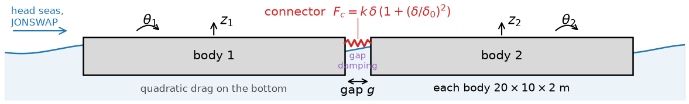
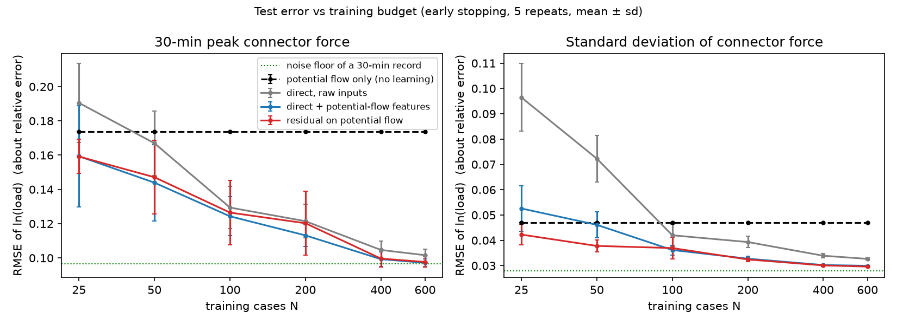

# Physics first, learn the remainder: a small test on connector loads of two floating modules

A one-week exercise. Two barges are connected by a spring. Linear potential flow predicts the connector load. A
synthetic nonlinear model plays the role of the truth. Neural networks learn the gap between the two, with or
without potential flow as prior knowledge, at equal training budget.



## Read this first: what this is and what it is not

- **The "truth" is synthetic.** It is a time-domain model built on the same potential-flow coefficients, with three
  nonlinear terms added: quadratic drag, a hardening connector and gap damping. **Their coefficients are assumed, not
  measured.** This is not CFD-FEM and not experimental data.
- **The claim is about the method, not about real load magnitudes.** The question is how much training data a
  network needs when potential flow is given as prior knowledge, compared with when it is not.
- **Two bodies, head seas, four inputs.** Multi-modular arrays, oblique seas and structural flexibility are not included.
- **Run A was pre-registered and run B is post-hoc.** Both are reported. See [Results](#results).
- **Development note.** The code was written with an AI coding assistant (Claude, Anthropic) under my direction. Every
  step, acceptance criterion, failed run and decision is recorded in [`LOG.md`](LOG.md), with the original output in
  [`logs/`](logs/).

## Results



RMSE of ln(load) on 192 in-distribution test cases, mean of 5 repeats (run B, early stopping):

| Model | N = 25 | N = 100 | N = 600 |
|---|---|---|---|
| Potential flow only, no learning (peak / σ) | 0.174 / 0.047 | 0.174 / 0.047 | 0.174 / 0.047 |
| Direct, raw inputs | 0.191 / 0.097 | 0.129 / 0.042 | 0.102 / 0.033 |
| Direct + potential-flow features | 0.159 / 0.053 | 0.124 / 0.036 | 0.097 / 0.030 |
| Residual on potential flow | 0.159 / 0.042 | 0.127 / 0.037 | 0.098 / 0.030 |
| Noise floor of one 30-min record | 0.097 / 0.028 | | |

What the evidence supports:

1. **Potential flow as prior knowledge cuts the data needed.** For the load standard deviation, the residual model with
   25 cases matches the raw-input model with 100 cases: about four times less data.
2. **Residual and physics-as-input tie on the peak load.** The residual model only varies less between repeats
   (sd 0.010 against 0.030 at N = 25). The claim "residual learning beats direct learning" holds against raw inputs.
   It does not hold against a direct model that is given the same potential-flow features.
3. **The training protocol matters as much as the architecture.** In the pre-registered run A, without early stopping,
   every network was worse than potential flow alone below N = 100. The residual model was the worst. A residual model
   is only safe at small N when it is kept close to its physics prior.
4. **With 400 cases or more, every network reaches the noise floor.** That is about half the peak error of potential flow.
   Beyond that point a 30-min statistic cannot be predicted better.
5. **Unseen configuration.** The 3 m gap was never used in training. All models generalise, with 5 to 12% higher error at N = 600.
   Split-conformal 90% intervals cover 0.93 to 0.95 in distribution and 0.87 to 0.91 on the unseen gap. They need recalibration
   for a new configuration.

All learning curves, both runs and both test sets: [`figures/step5_learning_curves.png`](figures/step5_learning_curves.png).

## Method

### 1. Linear potential flow (Capytaine BEM)

Two box barges, $20 \times 10 \times 2$ m, end to end, gap $g \in \{1.5, 2, 3, 4, 5\}$ m, head seas. The state is
$\mathbf{x} = [z_1, \theta_1, z_2, \theta_2]^T$. The connector is a vertical spring between the facing ends, with stretch

$$\delta = \mathbf{c}^T \mathbf{x}, \qquad \mathbf{c} = [-1,\ L/2,\ 1,\ L/2]^T .$$

In the frequency domain (time dependence $e^{-i\omega t}$, Capytaine's convention):

$$\left[-\omega^2\left(\mathbf{M}+\mathbf{A}(\omega)\right) - i\omega\,\mathbf{B}(\omega) + \mathbf{C} + k\,\mathbf{c}\mathbf{c}^T\right]\hat{\mathbf{x}} = \hat{\mathbf{F}}_{exc}(\omega), \qquad H_F(\omega) = k\,\mathbf{c}^T\hat{\mathbf{x}} .$$

### 2. Linear prediction in irregular seas

JONSWAP spectrum $S(\omega)$ with $\gamma = 3.3$, scaled so that $4\sqrt{m_0} = H_s$. Then

$$\sigma_F^2 = \int |H_F(\omega)|^2 S(\omega)\, d\omega, \qquad T_z = 2\pi\sqrt{m_{0,F}/m_{2,F}}, \qquad \mathbb{E}[F_{max}] \approx \sigma_F\left(\sqrt{2\ln N} + \frac{0.5772}{\sqrt{2\ln N}}\right),\ N = \frac{1800\ \text{s}}{T_z} .$$

### 3. Synthetic truth (Cummins equation)

$$(\mathbf{M}+\mathbf{A}_\infty)\ddot{\mathbf{x}} + \int_0^t \mathbf{K}(t-\tau)\dot{\mathbf{x}}(\tau)\,d\tau + \mathbf{C}\mathbf{x} = \mathbf{F}_{exc}(t) - \mathbf{c}\,F_c(\delta) + \mathbf{F}_{drag}(\dot{\mathbf{x}}) - \mathbf{c}\,c_g\,|\dot\delta|\dot\delta$$

$$\mathbf{K}(t) = \frac{2}{\pi}\int_0^{\infty}\mathbf{B}(\omega)\cos\omega t\, d\omega, \qquad \mathbf{A}(\omega) = \mathbf{A}_\infty - \frac{1}{\omega}\int_0^\infty \mathbf{K}(t)\sin\omega t\, dt \quad \text{(Ogilvie)}$$

Nonlinear terms (assumed coefficients):

$$F_c = k\,\delta\left(1 + (\delta/\delta_0)^2\right),\ \delta_0 = 0.5\ \text{m}; \qquad f_{drag}(x) = -\tfrac{1}{2}\rho C_D B\,|w|w,\ C_D = 1; \qquad c_g = 5\times10^4\,\frac{1.5\ \text{m}}{g}\ \text{kg/m}.$$

The linear and the nonlinear responses are computed on the identical wave realisation.

### 4. Dataset

1,200 cases, Latin hypercube over $H_s \in [0.5, 4]$ m, $T_p \in [6, 12]$ s, $\log_{10}k \in [5, 7]$, each gap 240 times.
Targets: the 30-min peak and the standard deviation of the connector force.

### 5. Learning

| Model | Prediction |
|---|---|
| Potential flow only | $\hat y = \ln y_{PF}$ |
| Direct, raw inputs | $\hat y = f_\theta(H_s, T_p, g, \log_{10}k)$ |
| Direct + PF features | $\hat y = f_\theta(H_s, T_p, g, \log_{10}k, \ln\sigma_F, \ln T_z, \ln\mathbb{E}[F_{max}])$ |
| Residual | $\hat y = \ln y_{PF} + g_\theta(\text{same inputs})$, $g_\theta$ initialised to zero |

All networks are the same MLP (2 × 64, SiLU, Adam, weight decay $10^{-4}$), trained on nested subsets of
N = 25 to 600 cases, 5 repeats. Split-conformal intervals use a separate calibration set:

$$\hat q = \text{Quantile}_{\lceil (n+1)(1-\alpha)\rceil/n}\left\{|y_i - \hat y_i|\right\}, \qquad \hat y \pm \hat q,\ \alpha = 0.1 .$$

## Verification

Every stage had acceptance criteria fixed before it ran. None was loosened after a result was seen.

| Stage | Main check | Result |
|---|---|---|
| BEM | reciprocity, identical bodies, long-wave limit, mesh 1.0 vs 0.5 m | all pass (max 0.7%) |
| BEM | Haskind relation (energy conservation) | 1.03 to 1.11 for ω ≤ 2.2 rad/s |
| Linear statistics | independent Monte-Carlo, 20 × 3 h | σ within 0.3% |
| Time domain | linear gate: nonlinear terms off vs frequency domain, 12 cases | σ within 1.5%, correlation 0.9999 |
| Time domain | time step halved | ≤ 0.6% |
| High-frequency damping | scaled × 0.5 and × 2 | residual changes ≤ 0.6% (p90) |

Several errors were caught by these checks and are kept in the log with their output. The most instructive one:
Capytaine's `mesh_rectangle(size=(a, b))` places `a` along y. A waterplane lid built with it was rotated by 90°. That
caused every lid failure, until it was found in Capytaine's own source.

## Reproduce

```bash
python -m venv .venv && . .venv/bin/activate
pip install -r requirements.txt
bash run_all.sh            # about 30 min on 30 cores; the dataset dominates
```

Exact versions: [`requirements.lock`](requirements.lock). The wheels used were checked against the published SHA256
hashes: [`provenance_wheels.tsv`](provenance_wheels.tsv).

## Repository layout

```
src/        bem_two_barges.py, check_bem.py      step 1  potential-flow coefficients and checks
            linear_fd.py                         step 2  linear prediction in irregular seas
            cummins_td.py, check_td.py           step 3  synthetic truth and gates
            bem_high_freq.py, make_dataset.py    step 4  damping to 4 rad/s, dataset
            train_compare.py                     step 5  direct vs residual learning
            diag_*.py                            diagnostics that decided the fixes
data/       BEM coefficients (.npz), dataset.csv (dataset_v1 kept, quarantined)
results/    step 5 results, both runs
figures/    every figure in this README and in the log
logs/       original output of every run, including the failed ones
LOG.md      step-by-step record
report/     technical report (PDF) with all equations
```

## References

- Ancellin, M. and Dias, F. (2019). Capytaine: a Python-based linear potential flow solver. *Journal of Open Source Software*, 4(36), 1341.
- Cummins, W. E. (1962). The impulse response function and ship motions. *Schiffstechnik*, 9, 101-109.
- Ogilvie, T. F. (1964). Recent progress toward the understanding and prediction of ship motions. *5th Symposium on Naval Hydrodynamics*, Bergen.
- Hasselmann, K. et al. (1973). Measurements of wind-wave growth and swell decay during the Joint North Sea Wave Project (JONSWAP). *Deutsche Hydrographische Zeitschrift*, A8(12).
- Newman, J. N. (1977). *Marine Hydrodynamics*. MIT Press. (Haskind relation)
- Kennedy, M. C. and O'Hagan, A. (2001). Bayesian calibration of computer models. *Journal of the Royal Statistical Society B*, 63(3), 425-464.
- Angelopoulos, A. N. and Bates, S. (2023). Conformal prediction: a gentle introduction. *Foundations and Trends in Machine Learning*, 16(4), 494-591.

## Author

Pedro Henrique de Melo Estrêlla · Erasmus Mundus Joint Master, Sustainable Ship and Shipping 4.0 (SEAS4.0) · [github.com/pedroestrellaa](https://github.com/pedroestrellaa)

License: MIT.
